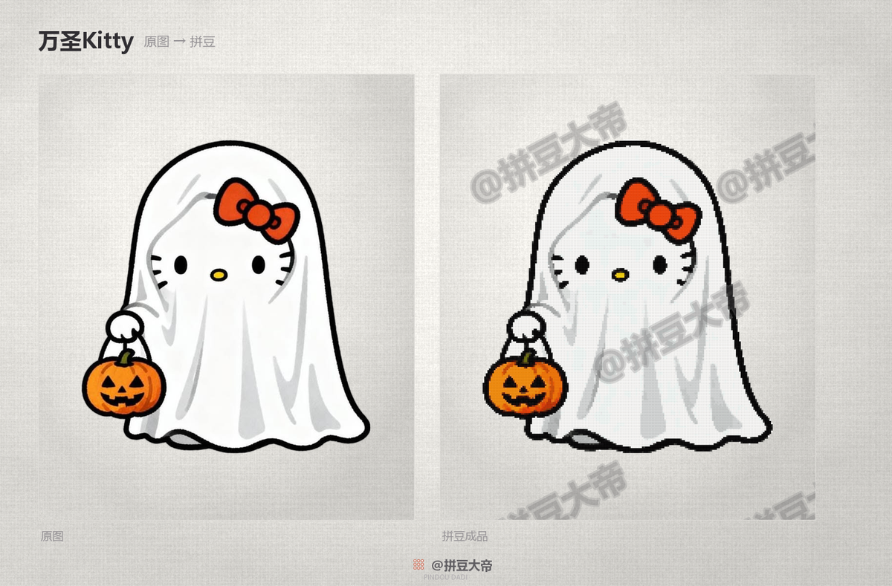
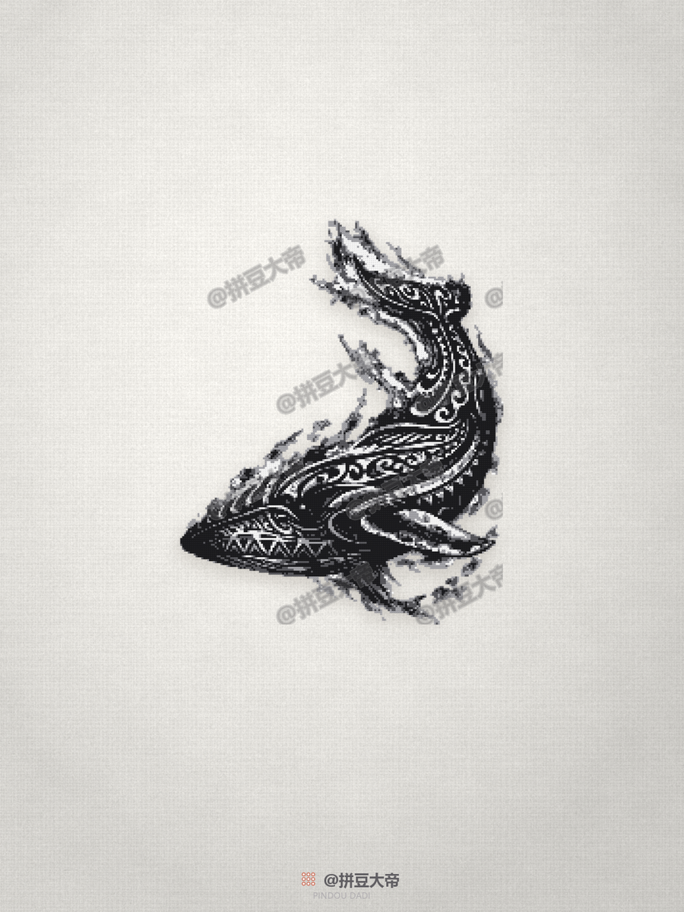
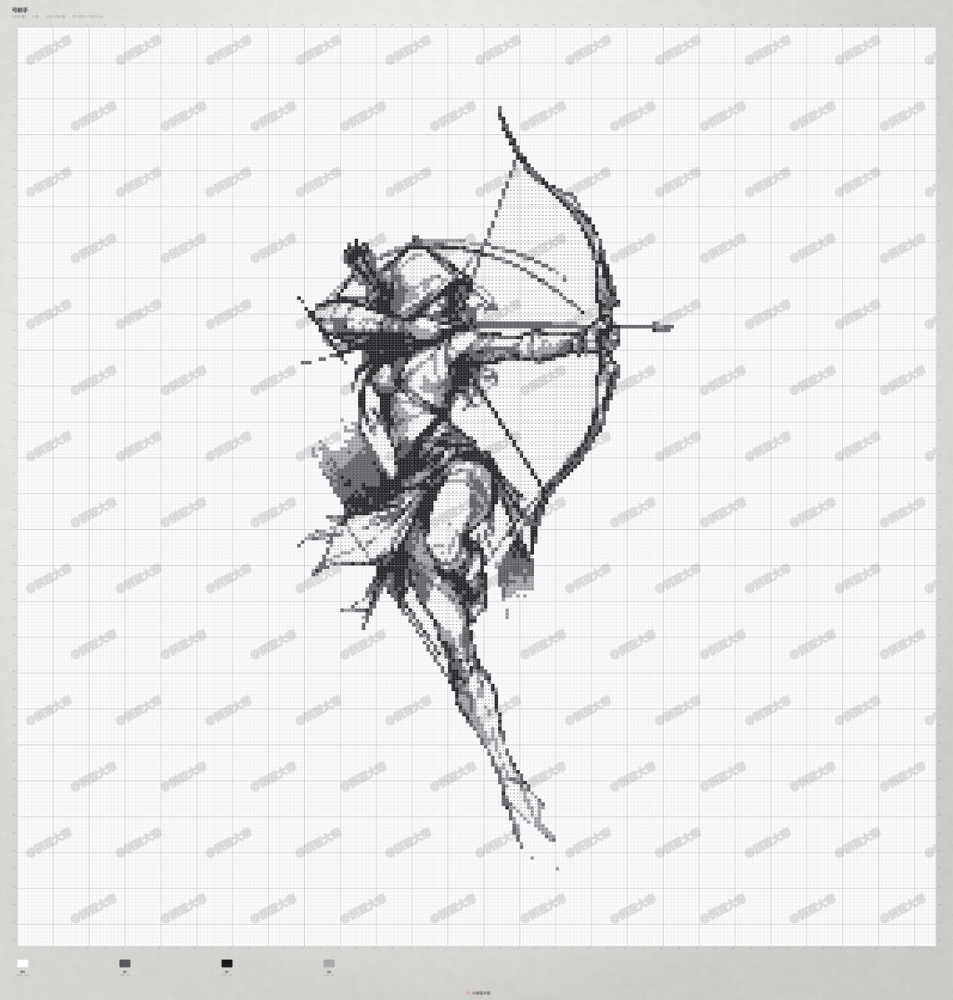

# 拼豆公子 · Pindou Gongzi

把任何图片变成能照着拼的拼豆图纸——四张成品图、带色号的图纸、可直接发布的文案台账，一条命令跑完。

不依赖任何特定平台。Python 3.9+，命令行。

## 📺 看看效果

[](screenshots/halloween-kitty-compare.png)

> ▶️ **[看完整画廊 →](#gallery)** — 67 件真实作品，从纹身手稿到艺术摄影

## What This Does

丢一个文件夹进来，出来的是可以直接卖的整套素材。

### Key Features

- **四张成品图** — 原图 / 成品图 / 色彩图（带色号）/ 对比图，一次生成
- **双版本** — 带水印（发社交）+ 无标（卖客户）
- **双轨取色** — 高保真版（128–256 格）+ 精品版（3–17 色）
- **自动分流** — 角色浮空 / 场景豆板 / 线稿灰阶 / 照片分割，任何图都能处理
- **文案台账** — Excel 里标题、正文、标签直接复制，规格自动填
- **质量评级** — 每件自动打 A/B/C，不达标的低色号版直接不出

## Installation

### WorkBuddy

```bash
git clone https://github.com/<you>/pindou-gongzi.git ~/.workbuddy-ai/skills/pindou-gongzi
pip install -r ~/.workbuddy-ai/skills/pindou-gongzi/requirements.txt
```

### Claude Code / 其他 Agent

```bash
mkdir -p ~/.claude/skills/pindou-gongzi
cp -R SKILL.md README.md config.json requirements.txt scripts references screenshots \
      ~/.claude/skills/pindou-gongzi/
```

然后把仓库链接丢给 agent，它会按 `SKILL.md` 的指引加载所需文件。

### ⚠️ 装完第一件事：改成你的品牌

图纸上的水印是**你自己的名字**，不是作者的。默认是占位符 `@你的品牌名`，不改就会印在图上。

```bash
# 方式一：直接改 config.json（会进 git，适合你就是仓库主人）
#   brand.name      → 你的品牌名
#   brand.watermark → @你的品牌名

# 方式二：建 config.local.json（不入库，推荐 fork 后使用）
echo '{"brand":{"name":"你的品牌名","watermark":"@你的品牌名"}}' > config.local.json
```

`config.local.json` 优先级高于 `config.json`，且已在 `.gitignore` 里，不会被提交。

### 手动验证

```bash
python scripts/doctor.py      # 依赖 / 字体 / 路径 / 品牌是否已改
python scripts/selftest.py    # 自造一张图跑通全流程
```

`selftest.py` 打印 `✓ 自检通过` 就说明环境没问题。

## Usage

### 批量出图

```bash
python scripts/auto_run.py --src ~/Downloads/拼豆素材
```

扫描目录 → 判断类型 → 抠图 → 双轨取色 → 四图输出 → 台账 → 清理 → 报告。

> 图片放进素材目录就行，文件名就是作品名。

### 先看看它怎么判断

```bash
python scripts/auto_run.py --dry
```

只打印每张图的分类和预处理动作，不出图。适合大批量前先确认。

### 其他常用

```bash
python scripts/auto_run.py --jobs 4          # 4 张并行
python scripts/auto_run.py --limit 3         # 先做 3 张试水
python scripts/auto_run.py --pdf             # 顺带出 A4 打印分页
python scripts/auto_run.py --check           # 已有产物体检
python scripts/wm_hint.py                    # 扫疑似水印位置
```

## 色号：真实品牌色板

图纸上的色号不是自己编的，是**真实能买到的品牌色号**。

内置 **5 个品牌色板**（社区开源映射数据）：

| 品牌 | 色数 | 配置值 |
|---|---|---|
| MARD | 291 | `"name": "mard"` |
| COCO | 291 | `"name": "coco"` |
| 盼盼 | 291 | `"name": "panpan"` |
| 咪小窝 | 291 | `"name": "mixiaowo"` |
| 漫漫 | 289 | `"name": "manman"` |

> ⚠️ 这 5 个品牌的**色值基本完全相同**（同一支豆不同叫法），区别只在色号命名和极少数缺色。
> 所以不存在「哪个品牌更适合这张图」——按**客户用哪个牌子**选就行，默认 MARD。

出图前把算出来的颜色吸附到最近的品牌色：

```
自编色号  K1 #2A2A2A  →  MARD  H06 #2F2B2F
自编色号  W1 #FAFAFA  →  MARD  H02 #FEFFFF
```

`config.json` 里可开关和换品牌：

```json
{ "palette": { "name": "mard", "enabled": true } }
```

关掉就回到自编色号（`"enabled": false`）。

## 降重（压缩体积）

89 件作品跑完约 **3.1 GB**，用 `compress.py` 压到 **1.7 GB**（省 45%），画质肉眼无差：

| 文件 | 处理 | 效果 |
|---|---|---|
| `01_原图` `02_成品图` `04_对比图` | 256 色量化 + 抖动 | 2.2MB → 0.6MB |
| `03_色彩图` | 256 色量化，不抖动（保文字） | 6.0MB → 3.1MB |

```bash
python scripts/compress.py            # 预演，只报数字
python scripts/compress.py --yes      # 真压
```

> 色号图不抖动是关键——抖动会让色号文字边缘发毛，读不清。

## 目录长什么样

交付目录只有 9 项，其余都在 `内部数据/` 里，不用管：

```
拼豆成品/
├── 分类/              带水印版，发社交
│   ├── 动漫人物/
│   ├── 风景/
│   └── 墨纹/
├── 无LOGO版/          客户交付，同样分三类
├── 精品版/            低色号版
├── 作品清单.xlsx      带缩略图，6 个 sheet
├── 文案_动漫人物.txt   手机上直接复制
├── 文案_风景.txt
├── 文案_墨纹.txt
├── 制作规范.md
└── 内部数据/          台账 / 备份 / 日志 / 缓存，平时不用打开
```

> 文件名全部中文，不用记英文。

## 作品清单（带图）

出图后自动生成 `作品清单.xlsx`，**每行带缩略图**，按分类分 sheet：

```
动漫人物     35 行 + 35 张缩略图
动漫人物·文案  正文/标签单独一张表，方便复制
风景 / 风景·文案
墨纹 / 墨纹·文案
```

配套导出：

| 文件 | 用途 |
|---|---|
| `文案清单_<分类>.csv` | 导入其他工具 |
| `文案_<分类>.txt` | 手机上直接复制 |

单独重生成（改了台账之后）：

```bash
python scripts/ledger.py              # 缩略图 88px
python scripts/ledger.py --thumb 120  # 更大
python scripts/ledger.py --no-text    # 只要概览
```

> 文件被 Excel 占用时会自动改存 `_新`，不会中断。

## 自动分类

出图后按风格自动归到 `分类/动漫人物`、`分类/风景`、`分类/墨纹`。

判定顺序：**名字关键词** → 线稿 → 场景 → 兜底（动漫人物）。
关键词写在 `config.json` 的 `categories.rules`，加词就能改分类，不用改代码。

```json
{
  "categories": {
    "order": ["动漫人物", "风景", "墨纹"],
    "fallback": "动漫人物",
    "rules": {
      "动漫人物": ["Q版", "Kitty", "路飞", "索隆", "山治"],
      "墨纹": ["飞龙", "曼陀罗", "弓箭", "龙"],
      "风景": ["云下", "山丘", "红裙", "白墙"]
    }
  }
}
```

单词关键词（如「浪」）只做完全匹配，避免「冲浪」被误判。
不想分类就加 `--no-cat`。

单独查看某个名字会分到哪：

```bash
python scripts/categorize.py 飞龙 云下红裙 Q版山治
```

## 四种处理模式

任何图片进来，都会被分到其中一条路。

### 角色

抠图后浮空贴在亚麻纸上，投影跟着轮廓走。适合有明确主体的插画、动漫角色。

### 场景

整幅做成豆板，带厚度和投影，像拼好放在桌上。适合风景、街拍、艺术摄影。

### 线稿

4 档灰阶，每格取暗分位保住细线。适合纹身手稿、素描、漫画线稿、文档截图。

> 线稿模式是唯一能做到 4 色的路径——因为线稿本来就只有黑白。

### 照片

grabCut 前景分割 + 覆盖率自检，抠不干净自动换方法。适合真人、实拍。

## Gallery

[](screenshots/halloween-kitty-compare.png) [](screenshots/dragon-product.png) [](screenshots/archer-chart.png)

> 左：万圣Kitty 原图与拼豆对比（7 色 4613 颗）｜中：纹身手稿「飞龙」4 色 16198 颗｜右：带色号的图纸，每格可读


## Architecture

| 文件 | 作用 | 何时加载 |
|---|---|---|
| `SKILL.md` | 触发条件、流程、10 条红线 | 每次会话 |
| `README.md` | 人类和 Agent 的入口文档 | 需要安装/理解时 |
| `config.json` | 品牌、路径、豆径、阈值 | 启动时 |
| `scripts/auto_run.py` | 主流程，一条命令跑完 | 出图时 |
| `scripts/cutout.py` | 抠图（平色判据 / grabCut） | 抠图时 |
| `scripts/lowcolor.py` | 低色号取色、线稿模式 | 降色号时 |
| `scripts/brand.py` | 亚麻纸、水印、四张成品图 | 渲染时 |
| `scripts/extras.py` | 预处理、查重、采购单、画廊、PDF | 按需 |
| `references/制作规范.md` | 748 行完整规范，含全部参数与踩坑 | 改参数前 |

## Philosophy

1. **不做模型，只做算法。** 取色是 k-means + 众数，不是神经网络。同样输入永远同样输出，不需要训练，也不需要 GPU。
2. **分辨率优先于色数。** 宁可 256 格 4 色，也不要 96 格 20 色——格数决定「看不看得出形状」，色数只决定「像不像」。
3. **碎点率是一等指标。** `speckle ≤ 0.048` 是硬门槛。低于这个值图才干净，客户才拼得动。
4. **宁可不出，不出次品。** 低色号版达不到标准就跳过，只留高保真版，不硬凑。
5. **配置驱动，不写死。** 品牌、路径、豆径、阈值全在 `config.json`。代码里出现魔法数字就是 bug。

## Requirements

- Python 3.9+
- `pip install -r requirements.txt`（pillow / numpy / scipy / openpyxl / opencv-python-headless）
- 中文字体：Windows 自带微软雅黑；macOS 用苹方；Linux 需装 Noto Sans CJK 或文泉驿

## Credits

Created by 公子 · [@你的GitHub](https://github.com/).

## License

MIT — Use it, modify it, share it.
