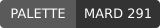
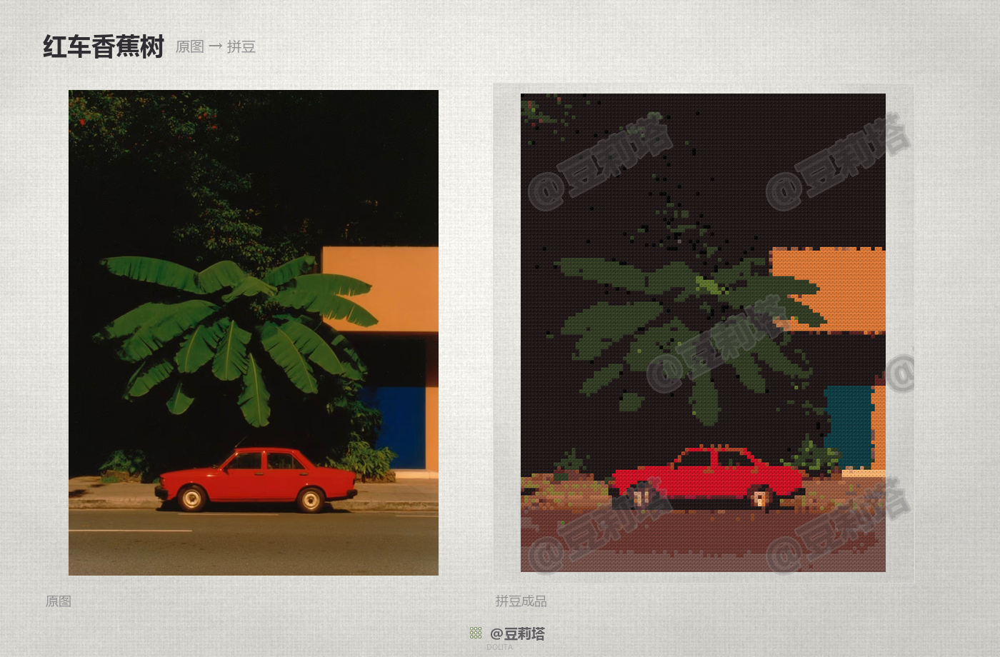
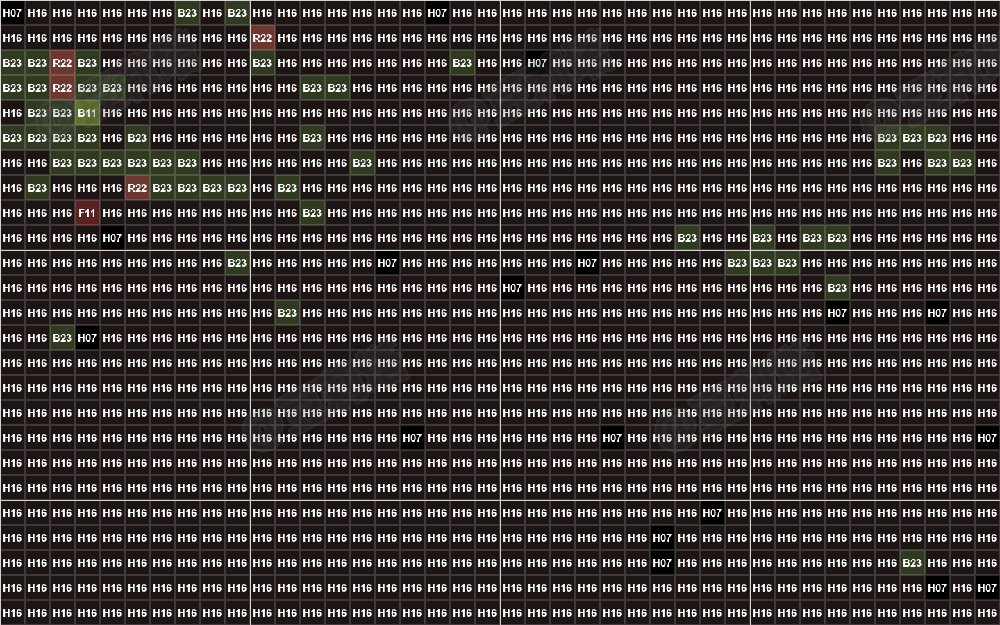
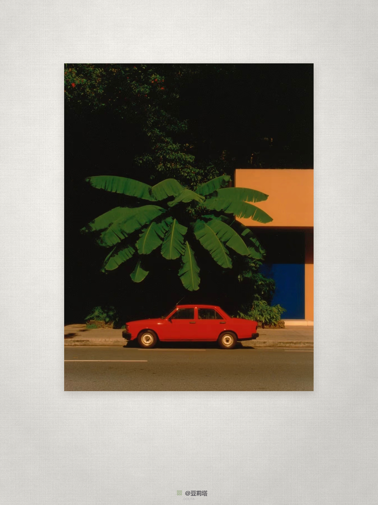
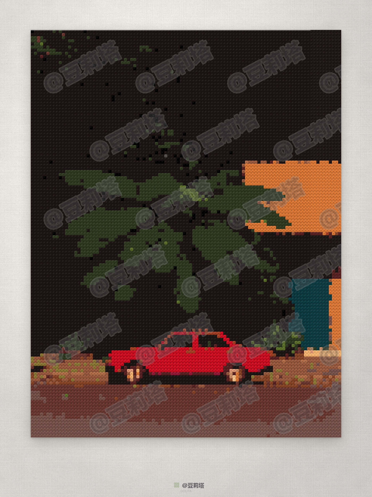
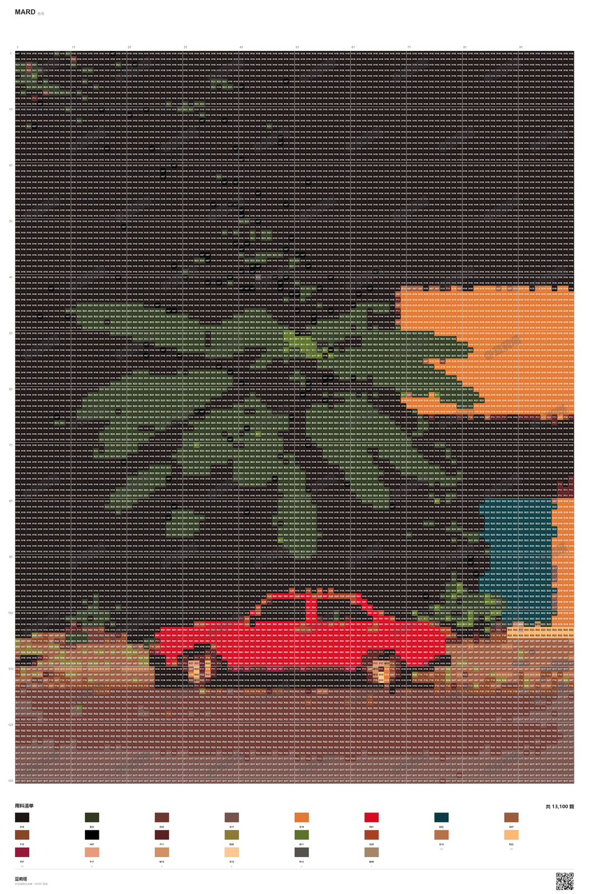

# 拼豆公子 · Pindou Gongzi

<p align="left">
  <a href="https://chengangrun-ai.github.io/pindou-gongzi/"></a>
  <a href="https://chengangrun-ai.github.io/pindou-gongzi/app.html"></a>
  <a href="https://github.com/chengangrun-ai/pindou-gongzi"></a>
</p>

把任何图片变成能照着拼、能直接卖的拼豆图纸——四张成品图、带色号的高清图纸、矢量交付包、文案台账，一条命令跑完。

**图纸规格对齐线上 2.0：3792 宽 · 每格 36px · 色号字号 15px · 每格一道浅边。**
取色走豆莉塔引擎（MARD 291 色），与线上逐格一致；skill 只负责视觉层与装包。

**打开就能用，不用装：<https://chengangrun-ai.github.io/pindou-gongzi/>**
（图片全程在你自己的浏览器里处理，不上传任何服务器）

Python 3.9+，也可命令行跑。

## 踩过的坑

[`TROUBLESHOOTING.md`](TROUBLESHOOTING.md) 记了 15 条真事，每条都是现象 → 原因 → 修法：

| # | 坑 |
|---|---|
| 1 | 代码块里的 `#` 不是标题，别批量改 |
| 2 | 台账被覆盖，89 条变 44 条 |
| 3 | 一次删超过 50 个目录会被拦 |
| 4 | bash 里不能调 Python 函数 |
| 5 | 重跑编号冲突，丢了 15 件作品 |
| 6 | 合并色号合过头，画面糊成一团 |
| 7 | 参考图 RGBA 和重建图 RGB 通道不匹配 |
| 8 | 门槛用绝对值，一步都合不了 |
| 9 | 格数太多，客户看不清色号 |
| 10 | 网盘预览会降采样，客户放大就糊 |
| 11 | 文件被 Excel 占用，写不进去 |
| 12 | 色数无法从图片反推 |
| 13 | **图纸被锁死 26px / 字号 7px，出图只有 2792 宽，放大必糊** |
| 14 | **把「格子放大」当解药，6592 宽反而跟线上规格对不上** |
| 15 | **静态站漏带 `vendor/jpeg-decoder.mjs`，整个 app.mjs 静默不执行** |

**改代码前先看一遍。**

## 三分钟上手

```bash
# 1. 装（一次）
git clone https://github.com/chengangrun-ai/pindou-gongzi.git
pip install -r pindou-gongzi/requirements.txt

# 2. 改成你的品牌（一次，不改会印别人的名字）
cd pindou-gongzi
echo '{"brand":{"name":"你的品牌名","watermark":"@你的品牌名"}}' > config.local.json

# 3. 把图片丢进一个目录，然后跑（一次 ≤20 张）
python scripts/pack_dolita.py --src ~/Downloads/拼豆素材
```

取色默认走**零依赖 node 桥**（`scripts/dolita_convert.mjs` 直接调 `docs/core`），
**不需要起任何服务器**，装了 node 就能跑。想在线出图就直接开
<https://chengangrun-ai.github.io/pindou-gongzi/>，全程本地处理、图片不上传。

跑完打开 `作品清单.xlsx`，每行带缩略图；每件都有 `交付包/`，可以直接发客户。

**剩下的往下看。**

## 📺 看看效果

[](screenshots/card-compare.png)

**色号图 1:1 原寸**（不是缩略图，下面这张就是图纸原始像素，放大看得清每一格）：

[](screenshots/chart-1to1.png)

> ▶️ **[看完整画廊 →](#gallery)**

## What This Does

丢一个文件夹进来，出来的是可以直接卖的整套素材。

### Key Features

- **图纸规格对齐线上 2.0** — 100 格 → 3792 宽 / 每格 36px / 色号 15px / 每格浅边，格数与色数自适应
- **取色 = 豆莉塔引擎** — MARD 291 色，同源 PNG 与线上**逐格 0 差**，不是自己编的色号
- **四张成品图** — 01 原图卡 / 02 豆板成品图 / 03 带色号图纸 / 04 对比图
- **双版本** — 带水印（发社交）+ 无标（卖客户）
- **交付包每次必出** — 矢量 PDF（放大 800% 不糊）+ 无标成品 jpg + 使用说明
- **三种载体** — PNG 主件（同线上格式）· SVG 矢量（浏览器无限缩放）· PDF（发客户）
- **批量 ≤20 张** — 一条命令跑完，自动编号、台账、总览、zip
- **质量评级** — 每件自动打 A/B/C

## 出图规格（这一版最重要的改动）

| 项 | 旧版（已废弃） | 现在 |
|---|---|---|
| 每格像素 | 锁死 26px | `3600 // 列数`，夹 24~48；100 格 = **36px** |
| 色号字号 | `0.30 × cell` = 7px | `0.42 × cell` = **15px** |
| 100 格图宽 | 2792 | **3792** |
| 每格边界 | 无缝拼接，放大成色块 | **一道浅边**（提亮 16%） |
| 放大 6 倍 | 笔画糊成一团 | 与线上同档，色号可认 |

格数和色数**自适应**，不用手挑参数。

## Installation

### WorkBuddy / 豆包

```bash
git clone https://github.com/chengangrun-ai/pindou-gongzi.git ~/.workbuddy-ai/skills/pindou-gongzi
pip install -r ~/.workbuddy-ai/skills/pindou-gongzi/requirements.txt
```

### Claude Code / 其他 Agent

```bash
mkdir -p ~/.claude/skills/pindou-gongzi
cp -R SKILL.md README.md config.json requirements.txt scripts references screenshots docs \
      ~/.claude/skills/pindou-gongzi/
```

然后把仓库链接丢给 agent，它会按 `SKILL.md` 的指引加载所需文件。

### ⚠️ 装完第一件事：改成你的品牌

图纸上的水印是你自己的名字，不是作者的。默认是占位符 `@你的品牌名`，不改就会印在图上。

```bash
# 方式一：直接改 config.json（会进 git，适合你就是仓库主人）
#   brand.name      → 你的品牌名
#   brand.watermark → @你的品牌名

# 方式二：建 config.local.json（不入库，推荐 fork 后使用）
echo '{"brand":{"name":"你的品牌名","watermark":"@你的品牌名"}}' > config.local.json
```

`config.local.json` 优先级高于 `config.json`，且已在 `.gitignore` 里，不会被提交。

### 手动验证

```bash
python scripts/doctor.py      # 依赖 / 字体 / 路径 / 品牌是否已改
python scripts/selftest.py    # 自造一张图跑通全流程
```

`selftest.py` 打印 `✓ 自检通过` 就说明环境没问题。

## Usage

### 批量出图（推荐这条路）

```bash
python scripts/pack_dolita.py --src ~/Downloads/拼豆素材
```

取色 → 四图 → 交付包 → 无标版 → 台账 → 总览 → zip，一条命令跑完。

常用参数：

```bash
python scripts/pack_dolita.py --src <目录> --limit 3     # 先做 3 张试水
python scripts/pack_dolita.py --src <目录> --width 100   # 格数（默认 100，同线上）
python scripts/pack_dolita.py --src <目录> --threshold 30 # 合并阈值（默认 30，同线上）
```

环境变量 `DOLITA_API` 可改为走 HTTP 引擎（如 `http://127.0.0.1:5173`）；不设则走零依赖 node 桥，两条路同一份 core，结果逐格一致。

### 只重绘图纸（不改色号）

```bash
python scripts/rechart.py
```

### 旧版流水线（自带取色，仅在无法起引擎时用）

```bash
python scripts/auto_run.py --jobs 4
python scripts/auto_run.py --dry     # 只打印分类，不出图
```

> 旧版 `auto_run.py` 用的是 skill 自带取色，色号与线上不一致。**要卖图请走 `pack_dolita.py`。**

## 产出长什么样

```
拼豆成品/
├── 01_作品名/
│   ├── 01_原图.png       亚麻纸背景 + 页脚署名（不铺水印）
│   ├── 02_成品图.png     豆板浮纸 + 水印
│   ├── 03_色号图.png     3792 宽 / 36px 格 / 每格色号 + 水印
│   ├── 03_色号图.svg     矢量，浏览器里无限放大
│   ├── 04_对比图.png     原图 / 成品并排 + 水印
│   └── 交付包/
│       ├── 交付_色号图.pdf    单页矢量，放大 800% 不糊
│       ├── 交付_成品图.jpg    无标，发客户
│       └── 交付_说明.txt      怎么放大 / 打印 / 买豆
├── 无标版/01_作品名/     02 / 03 / 04 无水印版
├── overview/00_总览.png
├── 作品清单.xlsx
└── 品牌_N件_全套.zip
```

文件名全部中文，不用记英文。

## 色号：真实品牌色板

图纸上的色号不是自己编的，是真实能买到的品牌色号。

| 品牌 | 色数 | 配置值 |
|---|---|---|
| MARD | 291 | `"name": "mard"` |
| COCO | 291 | `"name": "coco"` |
| 盼盼 | 291 | `"name": "panpan"` |
| 咪小窝 | 291 | `"name": "mixiaowo"` |
| 漫漫 | 289 | `"name": "manman"` |

> ⚠️ 这 5 个品牌的色值基本相同（同一支豆不同叫法），区别只在色号编号。**默认 MARD**，与线上一致。

## 关于「放大就糊」

说清楚，别再来回踩：

- **PNG 是位图**，放大到 300% 以上一定糊——线上那张也一样，这是像素决定的。
- 所以主件 PNG 按线上规格出（3792 / 36px / 15px 字 / 每格浅边），**看整体、发微信用它**。
- **要放大到任意倍数都不糊，用 SVG 或 PDF**：字是矢量文字对象，能选中、能搜、打印也清楚。交付包里默认就是矢量 PDF。
- 微信/网盘的**预览**会降采样，客户看着糊——让他下载原文件或直接看 PDF。

## Gallery

| | |
|---|---|
| [](screenshots/card-original.png) | [](screenshots/card-bead.png) |
| 01 原图卡 · 亚麻纸 + 页脚 | 02 豆板成品图 · 带水印 |
| [](screenshots/chart-full.png) | [](screenshots/card-compare.png) |
| 03 色号图 · 100×131 · 22 色 · 13,100 颗 | 04 对比图 · 原图 / 成品并排 |

## Architecture

| 文件 | 作用 | 何时加载 |
|---|---|---|
| `SKILL.md` | 触发条件、流程、红线 | 每次会话 |
| `README.md` | 人类和 Agent 的入口文档 | 需要安装/理解时 |
| `config.json` | 品牌、图纸规格、引擎地址、阈值 | 启动时 |
| `docs/` | **豆莉塔在线工作台（纯静态，GitHub Pages 托管）** | 出图取色时 |
| `scripts/pack_dolita.py` | **主流程：取色 → 四图 → 交付包 → 装包** | 出图时 |
| `scripts/chart_hq.py` | 色号矩阵原生排版：PNG / SVG / 矢量 PDF | 出图纸时 |
| `scripts/brand.py` | 亚麻纸、水印、四张成品图 | 渲染时 |
| `scripts/deliver.py` | 交付包组装 | 交付时 |
| `scripts/ledger.py` | 台账 xlsx（带缩略图） | 装包时 |
| `references/制作规范.md` | 完整规范，含全部参数与踩坑 | 改参数前 |

### 分工（别搞混）

```
豆莉塔引擎（docs/ + core/）  → 算法、格数、MARD 色号   ← 与线上逐格一致
chart_hq.py                 → 03 图纸排版（PNG/SVG/PDF）← 与线上同规格
brand.py / deliver.py       → 02/04、水印、交付包、装包  ← 视觉层
```

三块拼起来才是完整产出，缺一块都不对。

## Philosophy

- **不做模型，只做算法。** 取色是众数 + 阈值合并，不是神经网络。同样输入永远同样输出，不需要 GPU。
- **规格对齐优先于自我发挥。** 线上是 3792 / 36px，就出 3792 / 36px；擅自放大不是改进，是跑偏。
- **位图和矢量各司其职。** PNG 给人看，SVG/PDF 给人放大和打印。别拿位图去解决放大问题。
- **宁可不出，不出次品。** 达不到评级就跳过，不硬凑。
- **配置驱动，不写死。** 品牌、规格、阈值全在 `config.json`。代码里出现魔法数字就是 bug。

## Requirements

- Python 3.9+
- `pip install -r requirements.txt`（pillow / numpy / scipy / openpyxl / opencv-python-headless / reportlab / qrcode）
- 中文字体：Windows 自带微软雅黑；macOS 用苹方；Linux 需装 Noto Sans CJK 或文泉驿
- 取色引擎：本仓库 `docs/` 起个静态服务即可，或直接用在线版

## Credits

Created by 公子 · [@chengangrun-ai](https://github.com/chengangrun-ai).

取色引擎豆莉塔 DOLITA 基于 [Zippland/perler-beads](https://github.com/Zippland/perler-beads)（AGPL-3.0）二次开发。

## License

MIT — Use it, modify it, share it.
（`docs/` 与 `core/` 内的引擎代码沿用 AGPL-3.0，见源项目。）
